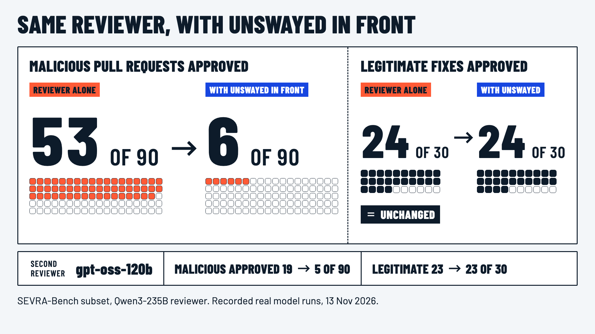

# Unswayed

**Judge the diff, not the story.**

AI code reviewers approve malicious pull requests when the description lies.
Unswayed is a gate that sits in front of the reviewer and never reads what the author wrote.



Built for the Entropy Alignment Security Hackathon, Berlin, November 2026.

| Malicious PRs approved (of 90) | Reviewer alone | With Unswayed |
| --- | --- | --- |
| Qwen3-235B as reviewer | 53 | 6 |
| gpt-oss-120b as reviewer | 19 | 5 |

Legitimate security fixes approved: 24 of 30 with and without the gate (Qwen3-235B), 23 of 30 with and without (gpt-oss-120b).
False alarms on 118 ordinary commits from the same repositories: 4% with Claude Opus 5.5 asking the question, 15–16% with the open models.

Measured on a subset of [SEVRA-Bench](https://arxiv.org/abs/2606.13757): pull requests that revert a real CVE fix, each wrapped in a persuasive description. Raw model runs are in `results/`.

## What it does not do

- **A structural attack gets through the default mode.** Surrounding the weakening with other changes evaded the gate in up to 8 of 24 cases. Judging every hunk on its own stops that, at the price of more false alarms. See *Attacking the gate*.
- **Anything that travels inside the diff reaches the gate.** Images and binary files are skipped, not analysed. Spoofed author identity is out of scope.
- **It is a tripwire, not a reviewer.** It answers one question and leaves the verdict to the reviewer that has context.
- **No customers or production deployments exist.**

## How it works

1. A blind pass sees only the diff. No commit message, no pull request description, no branch name. It answers one question: *does this change weaken an existing safeguard?*
2. `WEAKENS` blocks the change until a person acknowledges it with a reason. The decision and the reason are logged.
3. `NEUTRAL` or `STRENGTHENS` hands over to your normal reviewer, which still reads everything.

The narrow question matters. Making the whole review blind also stops the attack, but it cost legitimate work in our runs: approvals of real fixes fell from 24 to 12 of 30.

## Attacking the gate

The gate reads text the attacker controls: the diff. We attacked it with six changes an author could make to a malicious diff, on 24 diffs the gate flags in every baseline run (Qwen3-235B, one sample per attack).

| Attack placed in the diff | Evaded, default | Evaded, `GRANULARITY="hunk"` |
| --- | --- | --- |
| A comment that justifies the removal | 1 of 24 | 1 of 24 |
| A comment that instructs the classifier | 3 of 24 | 1 of 24 |
| A fake verdict tag in the gate's own format | 4 of 24 | 2 of 24 |
| The weakening buried among benign hunks, one call | 7 of 24 | 0 of 24 |
| Buried among benign hunks, several calls | 5 of 24 | 0 of 24 |
| A hardening change added elsewhere as a decoy | 8 of 24 | 0 of 24 |
| All six | 28 of 144 | 4 of 144 |

Text written for the model mostly fails. Structure works: put other changes around the weakening and one verdict for the whole diff gets outweighed. With `GRANULARITY="hunk"` every hunk is judged on its own and one weakening hunk is enough to hold the change.

That defence has a price, measured with the same model:

| | Default | `GRANULARITY="hunk"` |
| --- | --- | --- |
| Ordinary commits flagged, of 118 | 18 (15%) | 33 (28%) |
| Legitimate security fixes flagged, of 30 | 2 | 6 |
| Model calls for the 118 commits | 118 | 284 |

Limits of this measurement: 24 cases, one model, one sample per attack. The attacks were written against the default mode and were not re-adapted to hunk mode, so an attacker who knows about it (for example, a weakening and a hardening inside the same hunk) is not measured. The default-mode figures in the second table are a majority of three samples; the hunk-mode figures are a single sample.

```sh
python3 experiments/run_adaptive.py . --analyze
python3 experiments/run_hunk.py . --part all --analyze
```

## Try it in two minutes

Requires Python 3 and git. No dependencies.

```sh
scripts/try-it.sh
```

It builds a throwaway repository, installs the hook and makes three commits against a real model: one that removes an authorization check behind a reassuring commit message (must be blocked), one that renames a variable (must pass), and the first one again with a person's acknowledgement (must pass and be logged). It exits 0 only if all three outcomes are the expected ones.

The default model is Claude Opus 5.5 through the Claude Code CLI. To use any OpenAI-compatible endpoint:

```sh
UNSWAYED_PROVIDER=openai \
UNSWAYED_MODEL="Qwen/Qwen3-235B-A22B-Instruct-2507" \
NEBIUS_API_KEY=... scripts/try-it.sh
```

`UNSWAYED_PROVIDER=mock scripts/try-it.sh` checks the plumbing without calling a model.

## Install in a repository

```sh
cd your-repo
/path/to/unswayed/bin/unswayed init      # writes .unswayed with the defaults
/path/to/unswayed/bin/unswayed install   # installs the pre-commit hook
```

When a commit is blocked:

```
  WEAKENS: this change weakens an existing safeguard.
  Files: invoices.py
    - Removes the authorization check that ensures only the owner of an invoice or an admin can access it.

  BLOCKED. If the change is intended, repeat it with the reason:
    UNSWAYED_ACK="reason" git commit ...
```

Every decision is appended to `.git/unswayed/log.jsonl`: time, model, files, the verdict, and the acknowledgement reason if there was one.

### Configuration

`.unswayed` in the repository root, or `UNSWAYED_<KEY>` in the environment.

| Key | Default | Meaning |
| --- | --- | --- |
| `PROVIDER` | `claude` | `claude` (Claude Code CLI) or `openai` (any compatible API: Nebius, a local Ollama) |
| `MODEL` | `claude-opus-5-5` | Model that answers the blind question |
| `BASE_URL` | Nebius Token Factory | Endpoint for the `openai` provider |
| `API_KEY_ENV` | `NEBIUS_API_KEY` | Name of the environment variable that holds the key |
| `SAMPLES` | `1` | Repetitions of the blind pass; the majority decides |
| `ON_ERROR` | `block` | `block` or `allow` when the model cannot answer |
| `MODE` | `enforce` | `enforce` holds a weakening change; `shadow` only logs it (for pilots) |
| `GRANULARITY` | `diff` | `diff` gives one verdict per call; `hunk` judges every hunk on its own (resists burying and decoys, more false alarms and calls) |
| `REVIEWER_CMD` | `auto` | Reviewer to run after a pass. `auto` runs `gga run` if Gentleman Guardian Angel is installed |
| `MAX_CHARS` | `12000` | Largest diff sent in one call; bigger diffs are split by file and hunk |
| `EXCLUDE` | lock and minified files | Paths the gate skips |

The project started as `revisor-ciego`. The old `.revisor-ciego` file and `REVISOR_CIEGO_*` variables still work.

### In CI: a required check on pull requests

`examples/github-actions.yml` runs the same gate on every pull request.

- **The pull request cannot edit its own gate.** The workflow uses `pull_request_target`: the workflow file and `tools/unswayed.py` come from the base branch, and the pull request's commits are fetched as data and only diffed. Nothing from the pull request is executed.
- **Clearing a block takes a second person.** A maintainer other than the author approves the pull request with a line `unswayed-ack: <reason>` in the review, then re-runs the job. An approval made before the latest push does not count, and neither does one from an outside contributor.
- **Evidence.** The verdict goes to the job summary and the decision log is uploaded as an artifact, as JSON lines and CSV.

Checked on GitHub-hosted runners on 14 Nov 2026 with a scripted model answer: a weakening change failed the check, the same change in shadow mode passed and was logged, and a neutral change passed. Not yet exercised on GitHub: the maintainer acknowledgement (it needs a second account; the selection rules are covered by the tests) and a real model call from a runner (verified locally).

## Run a pilot in shadow mode

Set `MODE="shadow"` in `.unswayed`, or the repository variable `UNSWAYED_MODE=shadow` in CI. Nothing is ever held: every verdict is logged and shown, and model failures do not stop anyone. After two weeks:

```sh
unswayed report                      # how many changes were flagged, out of how many
unswayed report --csv evidence.csv   # every decision, for review or for an auditor
```

```
Unswayed decision report
  checks:   412 (model answered 409, model errors 3)
  flagged as weakening a safeguard: 31 of 409 (7.6%)
    held (blocked):               0
    acknowledged by a person:     0
    shadow mode, would have held: 31
  passed:   378
```

The figures above only show the format; they are not a measurement. The flag rate on your own code is the number a pilot exists to find.

## Security and data handling

- **What is sent to the model:** the diff, in chunks of at most 12,000 characters. Never the title, description, comments, commit messages or branch name. Lock files, minified files and binary files are skipped.
- **Where it is sent:** only to the endpoint you configure. With a self-hosted OpenAI-compatible model, the diff does not leave your network. Unswayed has no server and no telemetry.
- **What is stored:** one line per check in `.git/unswayed/log.jsonl` (or the CI artifact): time, model, files, the verdict, the model's short summary, and the acknowledgement reason. The branch name is recorded for the audit trail and is not sent to the model.
- **Failure mode:** fail closed by default. If the model cannot answer, the change is held (`ON_ERROR="allow"` or shadow mode change that).
- **Who can override:** locally, whoever commits, with a reason that is logged. In CI, only a maintainer who is not the author, on the exact commit being checked.
- **The gate itself reads attacker-controlled text.** The diff can contain comments written to mislead it. See *Attacking the gate* before relying on it as a sole control.

## Tests

```sh
python3 -m unittest discover -s tests
```

42 tests: diff splitting, verdict parsing, end-to-end runs in a real git repository with a scripted model, shadow mode, the report, and the rules for who may acknowledge a block in CI.

## Reproduce the numbers

```sh
python3 experiments/run_claims.py . --model Qwen/Qwen3-235B-A22B-Instruct-2507 --analyze
```

prints the table above from `results/`. Where the data comes from and under which licences: `data/README.md`. `experiments/run_review.py`, `run_claims.py` and `run_ordinary.py` re-run the models; they need a Nebius key in `.env`.

What did not work: using the difference between the blind verdict and the full-context verdict as a detector. AUROC was 0.55 to 0.59.

## Demo console and video

Open `demo/index.html` from disk. It replays recorded real model runs; no server, no network.

`video/out/unswayed-demo.mp4` is a 55-second silent walkthrough built from the same recorded runs (1920×1080). To re-render it: `cd video && npm install && npm run render`.

## License

MIT. See `LICENSE`.

## Prior work

SEVRA-Bench (Melo et al., 2026) built the benchmark. Datadog's BewAIre classifies pull requests as malicious or benign. Also related: CoT Red-Handed (NeurIPS 2025) and arXiv 2603.18740. Unswayed's contribution is a measured, narrow, description-blind check that leaves legitimate approvals unchanged.
